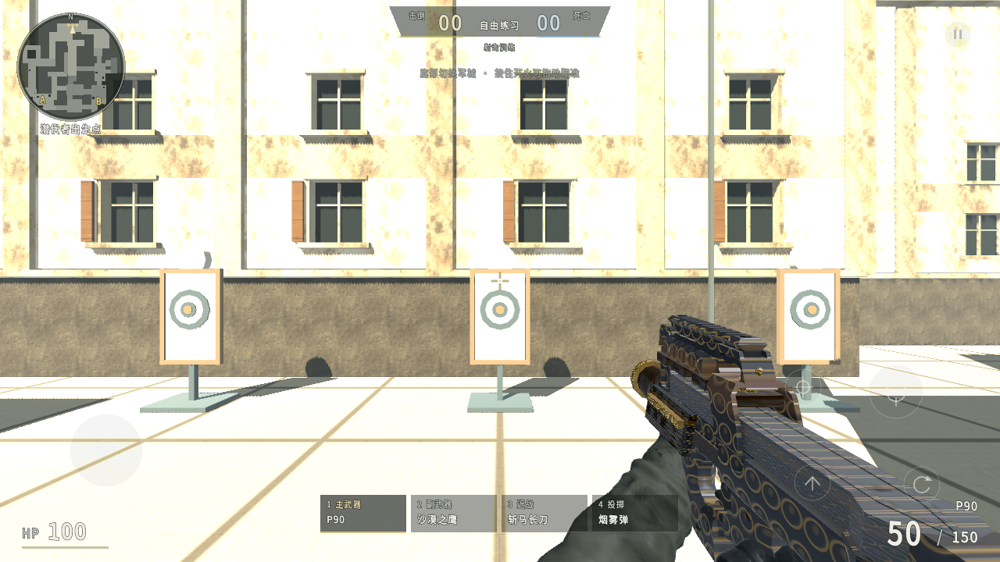
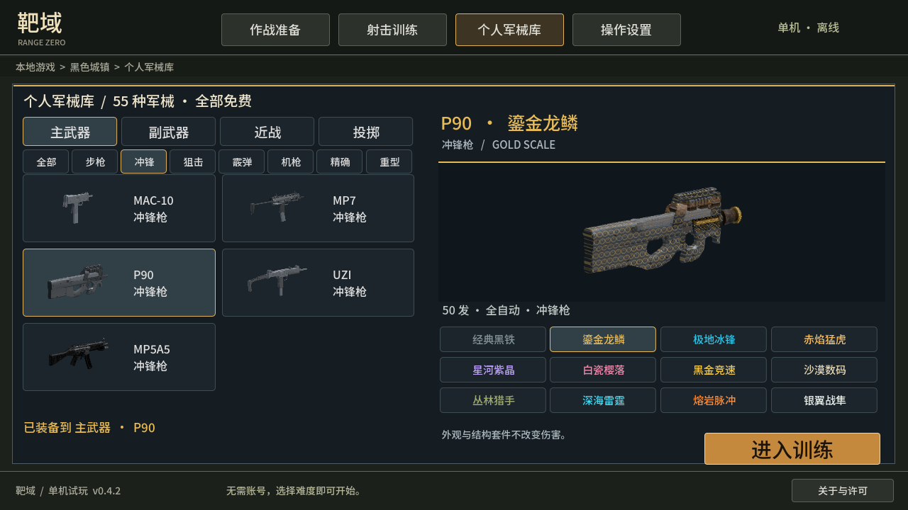

# 靶域 Range Zero

Android 离线第一人称射击试玩。自由移动、手动瞄准、开火换弹，随时练枪或与人机对战。

本仓库用于安装包分发和版本检查。

- [下载 0.4.2 APK，约 229 MiB](https://github.com/junnhwan/range-zero/releases/download/v0.4.2/RangeZero-0.4.2-android.apk)
- [加速下载](https://gh-proxy.org/https://github.com/junnhwan/range-zero/releases/download/v0.4.2/RangeZero-0.4.2-android.apk)
- [版本说明与备用文件](https://github.com/junnhwan/range-zero/releases/tag/v0.4.2)

## 试玩内容

0.4.2 为 11 款非原装皮肤启用自适应 3D 立体改装套件（龙脊护甲、消音器、全息镜、激光盒、制退器、赛博护翼）与浮雕/碳纤维/阳极氧化材质，重做 M134 加特林与 RPG-7 火箭筒造型，并加入持枪惯性、旋转抛壳、四翼枪口焰、连杀爆头反馈与黑色城镇包点细节。

- 一张黑色城镇简化重建练场，保留 A/B 地标、高低差、车厢、拱廊和水塔；提供靶场与 5 分钟人机对局。
- 55 种军械：41 把枪、11 种近战、破片/烟雾/闪光三类投掷。同一枪的外观不重复计数，全部免费。
- AK/M4/SCAR/FAMAS 等步枪，MP5/P90/UZI，AWM/M24/巴雷特，手枪、机枪、霰弹、精确步枪、加特林和火箭筒；近战有尼泊尔、斧、铁锹、武士刀、蝴蝶刀、斩马长刀等。
- 军械库分别配置主武器、副武器、近战、投掷，直接点枪系按钮筛选，滑动列表选枪；每把武器分别保存 12 种外观方案。
- 左侧移动、右侧转向，开火键可按住并拖动瞄准；点底部四槽切换。半自动按次触发，狙击镜缩放、霰弹散射、轻重击、手雷反弹、烟雾与闪光分别生效。
- 瞄准键对近战重击、对投掷低抛；开火为轻击/高抛。训练中投掷用尽可点“补给”。切枪保留弹药，外观不改变伤害。
- 三档难度、快速复活、随时暂停，本地保存设置和装备。默认 30 帧上限；对局有一盏太阳阴影、天空反射和轻微距离雾。设置可选 60 帧。

这些为实际 Android 模拟器截图。41 把枪的持枪、开镜、开火、换弹及 660 张军械库预览均已检查；加特林和火箭筒是程序化形体，仍有低模轮廓、共享手指贴合与程序化动作的局限。A 大烘焙街景保持原来的静态光照，敌人和大厅尚未做同等程度重制，真实手机的性能和手感尚待试玩。

## 安装与更新

Android 7.0 起，需支持 OpenGL ES 3.0。下载 APK 后直接覆盖安装，可保留本机设置和旧版皮肤；请勿先卸载。0.4.2 沿用原包名和原签名，已实测从 0.4.1 覆盖升级，四槽装备和各枪皮肤保留。

“操作设置 → 检查更新”限时尝试加速线路和官方源；发现更新后选择加速下载一/二/三或 GitHub 直连，在浏览器下载并安装，失败可返回换线。对局与本地资源无需联网，启动不自动查新。

## 更新清单与许可

`latest.json` 记录公开版本、版本码、APK 地址、字节数、SHA-256 和说明；`SHA256SUMS.txt` 用于核对文件。0.4.2 为 240,355,936 字节，SHA-256：`26898a75711b305436033a33d4cb16e110a2c537500bf96fb926257637a3029e`。

模型、贴图、字体和引擎的署名及许可保存在 APK 的“关于与许可”和 `THIRD_PARTY_NOTICES.txt` 中。游戏源码、工具和签名材料不在本公开仓库。
