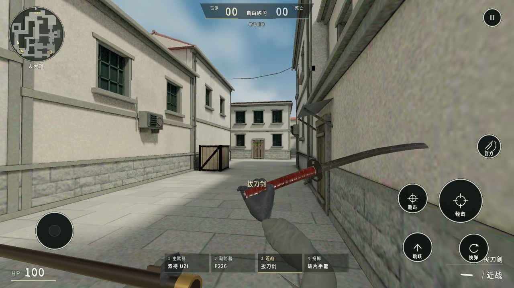

# 靶域 Range Zero

Android 离线第一人称射击试玩，自由移动、手动瞄准、开火换弹，可练枪或与人机对战。

- [下载 0.6.1 APK，约 255.5 MiB](https://github.com/junnhwan/range-zero/releases/download/v0.6.1/RangeZero-0.6.1-android.apk)
- [加速下载](https://gh-proxy.org/https://github.com/junnhwan/range-zero/releases/download/v0.6.1/RangeZero-0.6.1-android.apk)
- [版本说明与备用文件](https://github.com/junnhwan/range-zero/releases/tag/v0.6.1)

## 本版变化与试玩内容

0.6.1 修复被拉长的灰袖管、断开的手套与袖口，调整实际握持、换弹手指和拔刀剑路径。此版也包含持枪镜头、瞄准眼距、连发后坐力、枪口/抛壳反馈与场景光影的改进，并修复旧版 P90 切沙鹰的材质错误。

- 黑色城镇简化练场，靶场与 5 分钟人机对局；当前为玩家对 3 名人机，没有独立刀战或友方小队模式。
- 62 种装备：46 把枪、13 种近战、破片/烟雾/闪光三种投掷；每种有 12 个外观，全部免费。新增鲁格、左轮、毛瑟匣枪、双 M1911、双 UZI、双短刃与拔刀剑。
- 军械库配置主武器、副武器、近战和投掷。人机随机携带主武器与皮肤，死亡掉落，可近距拾取并继承外观和余弹；地图随机刷新武器尚未实现。
- 左侧移动、右侧转向；开火可按住并拖动瞄准，底部四槽切换。近战轻重击、投掷高低抛分别操作；设置与军械配置本地保存。
- 狙击可设置点击开镜、按住拖动松手保持，或按住拖动松手射击；取消触摸、暂停和切枪不会误射。

部分枪体与手套形体仍简化，专门动作和整体自然度还需继续完善。模拟器检查不代表真实手机流畅度、温度、续航或用户视觉认可。30/60 帧均为上限设置。

以下为 0.6.1 Android 模拟器实际画面：

## 安装与更新

Android 7.0 起，需支持 OpenGL ES 3.0。沿用原包名和签名，下载后直接覆盖安装，请勿先卸载。本机设置、装备与外观的覆盖升级验证结果见版本说明。

“操作设置 → 检查更新”会限时尝试固定加速线路和官方源；选择线路后在系统浏览器下载，失败可换线。启动不自动查新，对局与本地资源无需联网。

## 文件与许可

APK 为 267,949,429 字节，SHA-256：`b9dca40fec10bd83e5ae3f924bc72ccd5f55337b53be12bfc07be146872b19d3`。`latest.json` 记录版本、文件地址、大小与校验值，`SHA256SUMS.txt` 可供核对。

模型、纹理、字体和引擎许可见 APK 的“关于与许可”及 `THIRD_PARTY_NOTICES.txt`。本公开仓库仅分发安装包和资料，源码、工具、日志和签名材料不公开。
