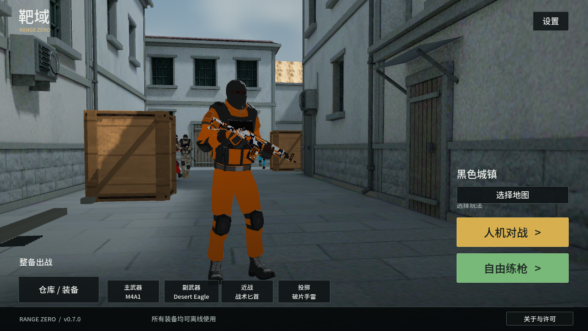

# 靶域 Range Zero

Android 离线第一人称射击游戏，自由移动、手动瞄准、开火换弹，可练枪或与人机对战。

- [下载 0.7.0 APK，约 318.1 MiB](https://github.com/junnhwan/range-zero/releases/download/v0.7.0/RangeZero-0.7.0-android.apk)
- [加速下载](https://gh-proxy.org/https://github.com/junnhwan/range-zero/releases/download/v0.7.0/RangeZero-0.7.0-android.apk)
- [版本说明与备用文件](https://github.com/junnhwan/range-zero/releases/tag/v0.7.0)

## 本版变化与试玩内容

0.7.0 接入 18 套配套枪体、手臂及关键帧动作，补齐冲锋枪开火、走跑、收拔枪和适用的瞄准换弹。新增具有弧线弹道、碰撞爆炸和独立装填的单发榴弹发射器。目录共 63 件：47 枪、13 近战、3 投掷。

18 套参考武器支持 238 个共享材质实例，恢复对应法线、粗糙度、金属和发光，军械库可分页、实时预览并保存；其他装备保留自身 12 款外观。新增 4 套配对手部／人物装具。238 是共享材质目录数，不是每把枪另有 238 套独立设计。

配套枪声、换弹、脚步、投掷和爆炸声音已接入；换弹声音随动作阶段同步，暂停和切枪停止。大厅跟随当前主武器、皮肤与装具，人机使用实际枪体、涂装、移动和换弹动作，死亡掉落可拾取的对应武器与余弹。修复独立瞄具释放后换肤可能崩溃，以及部分瞄准遮挡、发光过曝问题。

黑色城镇简化练场、自由训练与玩家对 3 名人机对局可完全离线运行。军械库分别配置四槽装备，支持三档狙击手势、近战轻重击、投掷高低抛与本地存档。

以下为 0.7.0 Android 模拟器原生画面：

部分枪型、双持／特殊装填接触、人物受击／死亡和场景细节仍需精修。30／60 帧为设置上限，模拟器验证不代表 vivo 真机持续帧率、温度或触屏手感。

## 安装与更新

Android 7.0 起，需支持 OpenGL ES 3.0。沿用原包名和签名，下载后直接覆盖安装，请勿先卸载。“操作与设置 → 检查更新”仅在主动打开时联网，提供三条固定加速线路与 GitHub 官方备用入口，通过系统浏览器下载。

## 文件与许可

APK 为 333,501,940 字节，SHA-256：`9008fe1d4077dfd836f462d324240733bc26eabdb3dec1cf60ffc69dbe95e62c`。`latest.json` 保存版本、下载地址、大小与校验值；`SHA256SUMS.txt` 可供核对。

模型、动画、贴图、声音、字体和引擎署名见 APK“关于与许可”和 `THIRD_PARTY_NOTICES.txt`。本仓库仅分发安装包与资料，源码、工具、日志和签名材料不公开。
